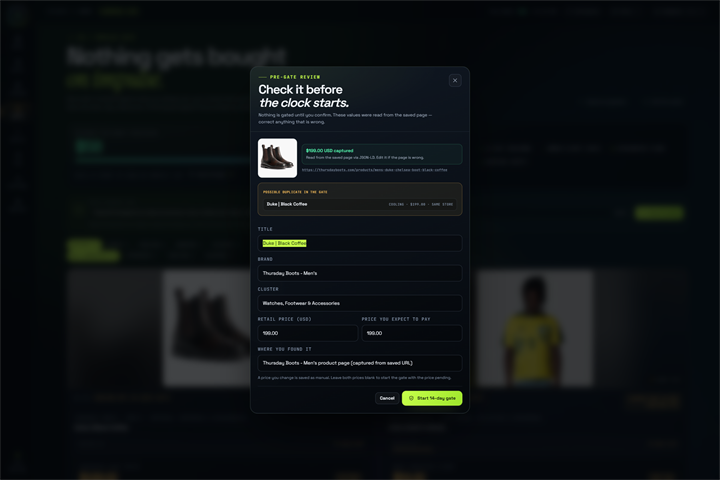
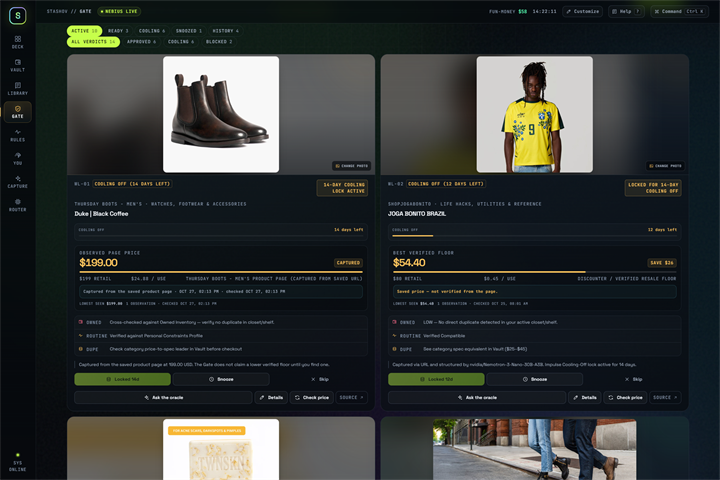
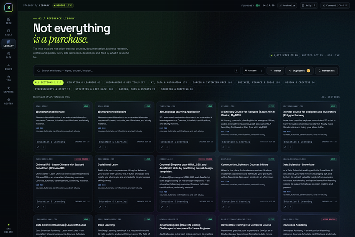
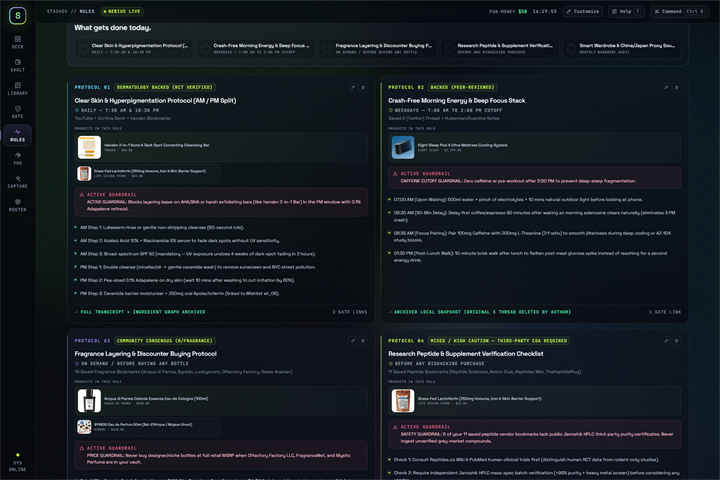
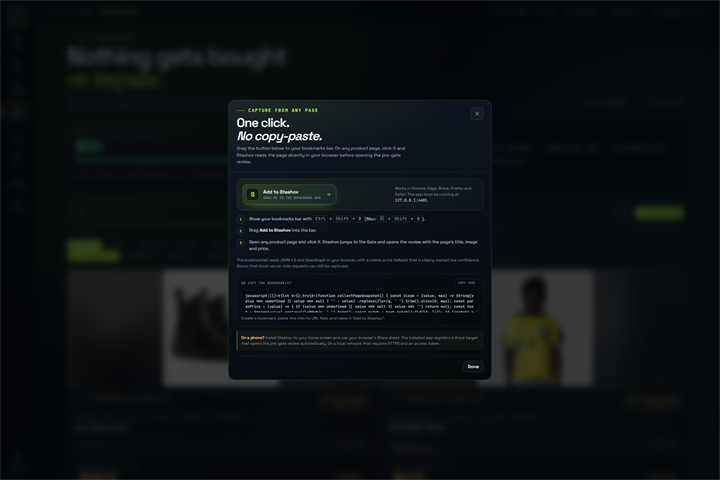
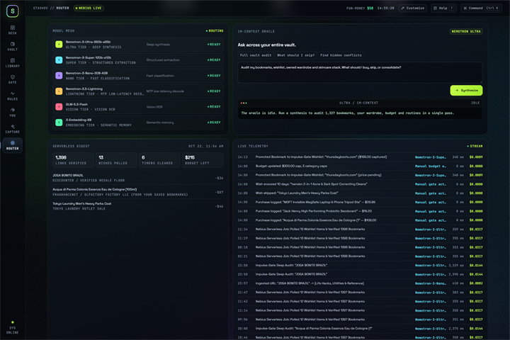
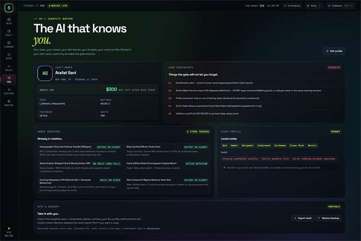
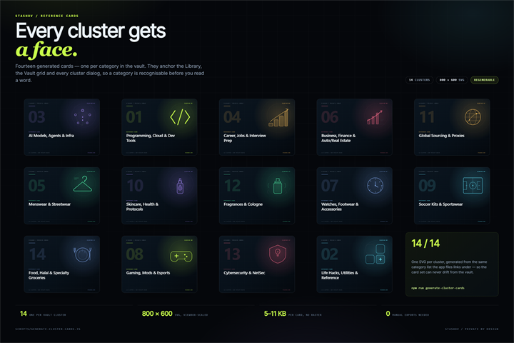
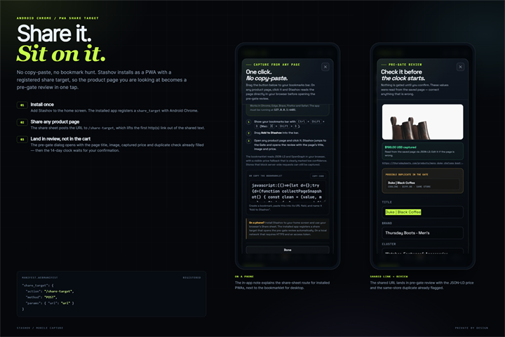
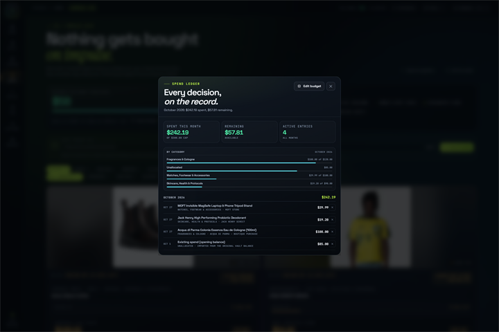

# Stashov — Context-Aware Personal AI Memory, Browser Bookmark Vault & Impulse Gate

[](./LICENSE)
[](#)
[](#)

**Stashov** is an always-on, private **Personal AI** built for the **Nebius x NVIDIA Global AI Hackathon (Personal AI Track)**. It ingests your real browser bookmarks (Chrome, Brave, Edge), camera-roll screenshots, and video/social links, organizes them into a semantic memory vault, converts static life hacks into conflict-checked daily protocols, and runs a strict **Impulse-Gate Buyer Engine** against what you already own and your monthly budget.

---

## Why Stashov Exists

Regular bookmark folders and wishlist apps fail in two ways:
1. **Retrieval & Link Rot:** Saved posts across TikTok, X, YouTube, Reddit, and Chrome/Brave bookmark bars rot or drown in unorganized folders and camera-roll screenshots.
2. **Zero Personal Context:** A standard wishlist doesn't know you *already own* two charcoal hoodies and a winter parka, that a viral skincare cleanser contains acids that conflict with your evening `0.1% Adapalene` retinoid routine, or that you already bookmarked four fragrance wholesale discounters that carry the same cologne for $87 less.

Stashov unifies your **saved bookmarks**, **wishlist**, **living routines**, and **personal constraints** into one connected brain on open infrastructure you control.

---

## Nebius Token Factory & NVIDIA Model Routing

Every task in Stashov is routed to the optimal open-weight model on **Nebius Token Factory** (`https://api.tokenfactory.nebius.com/v1`):

| Cognitive Tier | Model on Nebius Token Factory | Role in Stashov |
| :--- | :--- | :--- |
| **1M-Context Deep Reasoning** | `nvidia/Nemotron-3-Ultra-550b-a55b` | Vault-wide synthesis across 1,346 bookmarks, "Talk Me Out of Buying This" impulse audits, skincare/supplement conflict detection, and weekly digests. |
| **Mid-Tier Agentic Synthesis** | `nvidia/Nemotron-3-Super-120b-a12b` | Promoting bookmarks into structured wishlist cards, protocol checklist generation, and dupe comparison. |
| **Fast Structured Extraction** | `nvidia/Nemotron-3-Nano-30B-A3B` | Sub-second URL/transcript classification, auto-tagging across 14 categories, and function-calling price schema extraction. |
| **Vision OCR Ingestion** | `zai-org/GLM-5.3-Flash` / `Qwen3.8-27B` | Camera-roll screenshot OCR (extracting product names, prices, brands, and routine steps from mobile screenshots). |
| **Unified Semantic Memory** | `Qwen/Qwen3-Embedding-8B` | Embedding bookmarks, wishlist items, owned inventory, and protocols for semantic search and automatic cross-linking. |
| **Autonomous Background Worker** | **Nebius Serverless Jobs** (`jobs/nebius-serverless-worker.js`) | Scheduled deal/discounter polling, link-rot verification, cooling-off timer unlocks, and digest compilation. |

---

## Key Features Implemented

1. **Automated Browser Bookmark Importer & 14-Category Organizer (`scripts/sync-bookmarks.js`):**
   - Automatically scans local **Google Chrome**, **Brave Browser**, and **Microsoft Edge** bookmark stores.
   - Deduplicates **1,346 unique bookmarks** and classifies them into **14 structured categories** (Programming & Cloud, AI Models & Infra, Career & Interview Prep, Menswear & Streetwear, Fragrances & Cologne, Skincare/Health & Protocols, Watches/Footwear & Accessories, Soccer Kits, Global Sourcing Proxies, etc.).
   - **Reference Library:** separates the **1,017 non-shopping links** into 10 reference shelves (Education, Programming, AI, Career, Business, Design, Cybersecurity, Utilities, Gaming, Sourcing), with a live check, a short description, and a "use for" note on every entry. Confirmed-dead links are removed; bot-blocked and timeout entries stay marked for review. A post-audit review restored 9 false positives and logged every decision in `data/library-removal-review.json`.
   - **Duplicate review and bulk shelf care:** a canonical-URL scan finds pages saved more than once (ignoring `utm_*`, `fbclid`, `www`, trailing slashes and parameter order) and lets you keep one copy while archiving the rest. Select mode adds archive, restore, and move-to-section actions; archived links stay recoverable from the **Archived** status filter.
   - **Generated cluster reference cards:** every one of the 14 clusters has a dedicated 800x600 SVG card in `public/cluster-cards/`, rendered on the cluster board for reference clusters and used as the fallback cover when a product cluster has no cached product image. Product clusters keep their live wishlist photos and thumbnails so the cover is always the actual item. Regenerate all cards with `npm run generate-cluster-cards`.
2. **Smart Buyer & Impulse-Gate Engine:**
   - **"Already Own" Closet & Shelf Overlap Check:** Blocks duplicate impulse saves (e.g., flagging a saved parka when you already own a Black Quilted Winter Parka).
   - **Pre-gate review with real prices (`lib/product-info.js`, `lib/promotion.js`):** A bookmark now opens a review dialog before it enters the Gate. Stashov reads the product page's JSON-LD or OpenGraph metadata for title, brand, currency, price, and image, and shows exactly what it found. Nothing is gated until you confirm, so a wrong title or price can be corrected first. The card labels the source as **captured**, **manual**, or **missing**, and every field stays editable from the Details dialog. Missing prices never become fake `$95` placeholders.
   - **Paste-a-link quick add:** the Gate accepts a raw product URL, with a **Paste** button that reads the link from the clipboard, so a product found in a video, chat, or social feed can go from link to reviewed wishlist item without hunting through 1,346 bookmarks. The command palette also jumps straight to this field.
   - **One-click capture bookmarklet (`#captureDialog`):** open **Capture anywhere** in the Gate, drag **Add to Stashov** to the bookmarks bar, then click it on any product page. The bookmarklet reads the page’s JSON-LD/OpenGraph title, brand, price, currency, and image directly in the browser, then opens `/?capture=<page-url>` with that snapshot. When structured metadata is absent, it can read a visible price from the product area and explicitly marks it **low confidence** in the review, Gate card, and saved price note. That fallback prefers the current sale price over a struck compare-at price, follows the selected variant when variants show their own prices, and refuses ranges, "from" prices, installment copy, shipping thresholds, and per-unit prices instead of guessing. This keeps the review working on stores that return 403 to server-side requests. If the page exposes no metadata or visible price, the server-side reader remains the fallback. The dialog also provides copyable bookmarklet code and a mobile fallback note. The capture URL is consumed once so refreshes do not repeat the review.
   - **Monthly Fun-Money Ledger with editable caps:** Every Bought action writes one auditable ledger entry. The month's spend, remaining budget, and over-budget state are derived from that ledger, so the month resets automatically on the 1st. The cap and optional per-category caps are editable from the ledger, which also shows a category breakdown and month-by-month history.
   - **Discounter & Chemical/Spec Dupe Finder:** Cross-links retail product saves against your own bookmarked discounters (`Olfactory Factory LLC`, `FragranceNet`, `Quince`, `Thursday Factory Seconds`).
   - **14-Day Cooling-Off State Machine (`lib/gate.js`):** New saves get `added_at`, `unlock_at`, and a real lifecycle (`cooling → ready → bought/skipped/snoozed`). Every countdown is derived from timestamps, not seed text. **Snooze** pushes the decision out 7/14/30 days, **Skip** archives without spending, and **Buy** is rejected until the gate clears. An archived wish can be **reopened**, and a mistaken ledger entry can be **voided** while staying in the data file for audit.
   - **Price history, targets and re-checks:** every capture, manual edit, and **Check price** action appends a timestamped observation to the wish. Gate cards show a sparkline, lowest-seen price, observation count, and last-checked time. Set an optional target price in Details; the Gate flags the wish when the observed price meets it. Re-checking is rate limited and uses the same SSRF-safe reader as promotion.
   - **Duplicate warning before the clock starts:** the review dialog compares the incoming title against active wishes and surfaces likely duplicates (with the matching price and same-store hint) before you start a new 14-day gate.
   - **Editable You profile (`lib/profile.js`):** **You → Edit profile** changes your name, location, sizing, hard constraints, owned inventory and scent notes without touching JSON. The server validates every field, protects budget/cooling fields, preserves inventory IDs, and writes the vault atomically. The Gate and oracle read the updated context immediately.
   - **Export, restore and automatic snapshots:** download the whole vault, sections, and cluster covers from You → Data & Backups. Restoring validates the file, writes a `pre-*` snapshot when local storage allows, then replaces the vault. Local writes are atomic, keep the previous file as `.bak`, and rotate timestamped snapshots in `data/backups` (last 20).
3. **Living Playbooks, Routine Builder & Conflict Detector:**
   - Converts static life-hack bookmarks into structured Morning/Evening protocols (Clear Skin AM/PM Split, Crash-Free Energy Stack, Fragrance Layering & Discounter Rules, Research Peptide COA Safety Checklist).
   - **Paste-to-routine builder:** paste a TikTok/YouTube caption or product list into Rules, generate AM/PM steps, review the guardrail, then save, edit, or delete the protocol.
   - **Product photos inside routines:** link any wishlist items to a protocol. The first becomes a featured product tile and the rest sit in the product rail, each showing its cached photo, brand, verified price, and a click-through to its Gate card. The parser pre-links products it recognizes from the pasted text; the routine dialog lets you correct the selection.
   - Actively flags ingredient/routine conflicts (e.g., blocking an exfoliating acid cleanser in the PM window alongside `0.1% Adapalene`).
   - **Today's Playbook:** check off routines for the current day, see the daily completion count and streak, and uncheck a mistaken tap. The log is stored per protocol in the vault and is capped for readability.
4. **Capture from anywhere, including a phone:**
   - Desktop: the **Add to Stashov** bookmarklet, or paste a product link directly into the Gate.
   - Mobile: install the PWA from a share menu. The web manifest registers a **Web Share Target** at `/share-target`, so sharing a product link from Chrome/Android opens the pre-gate review (`/?capture=…`). HTTPS is required outside localhost.
   - The app also persists the active tab, Gate lane, Library section/status/search, and Vault cluster in the URL hash, so refresh and Back preserve the view.
5. **2-Second Ingest Studio & Transparent Router Telemetry:**
   - Ingests URLs, camera-roll screenshots, or notes and logs live model routing latency, token usage, and cost in the **Nebius Token Factory Telemetry Console**.

---

## Gallery

Ten frames captured from the running app, each **1800 × 1200 (3:2)** and under 5 MB — the same set used for the submission gallery, in upload order. Every thumbnail below opens the full-resolution file; the complete set lives in [`screenshots/gallery/`](screenshots/gallery), with capture notes in its [README](screenshots/gallery/README.md).

<table>
  <tr>
    <td width="50%" valign="top">
      <a href="screenshots/gallery/gate-review.png"></a><br>
      <sub><b>1. gate-review.png</b> — Pre-gate review dialog with JSON-LD capture, duplicate warnings, price provenance</sub>
    </td>
    <td width="50%" valign="top">
      <a href="screenshots/gallery/impulse-gate.png"></a><br>
      <sub><b>2. impulse-gate.png</b> — Gate lane view: cooling/ready/bought/skipped/snoozed with countdown timers</sub>
    </td>
  </tr>
  <tr>
    <td width="50%" valign="top">
      <a href="screenshots/gallery/library-audit.png"></a><br>
      <sub><b>3. library-audit.png</b> — Reference library with 10 sections, health status badges, duplicate clusters</sub>
    </td>
    <td width="50%" valign="top">
      <a href="screenshots/gallery/routine-conflict.png"></a><br>
      <sub><b>4. routine-conflict.png</b> — Clear Skin PM protocol flagging AHA/BHA conflict with Adapalene</sub>
    </td>
  </tr>
  <tr>
    <td width="50%" valign="top">
      <a href="screenshots/gallery/capture-bookmarklet.png"></a><br>
      <sub><b>5. capture-bookmarklet.png</b> — Capture dialog with draggable bookmarklet and mobile fallback note</sub>
    </td>
    <td width="50%" valign="top">
      <a href="screenshots/gallery/telemetry-console.png"></a><br>
      <sub><b>6. telemetry-console.png</b> — Nebius Token Factory routing latency, token usage, cost per call</sub>
    </td>
  </tr>
  <tr>
    <td width="50%" valign="top">
      <a href="screenshots/gallery/profile-editor.png"></a><br>
      <sub><b>7. profile-editor.png</b> — Editable You profile: sizes, constraints, owned inventory, scent notes</sub>
    </td>
    <td width="50%" valign="top">
      <a href="screenshots/gallery/cluster-cards.png"></a><br>
      <sub><b>8. cluster-cards.png</b> — 14 generated 800×600 SVG reference cards</sub>
    </td>
  </tr>
  <tr>
    <td width="50%" valign="top">
      <a href="screenshots/gallery/mobile-share.png"></a><br>
      <sub><b>9. mobile-share.png</b> — PWA Web Share Target flow from Android Chrome</sub>
    </td>
    <td width="50%" valign="top">
      <a href="screenshots/gallery/ledger-budget.png"></a><br>
      <sub><b>10. ledger-budget.png</b> — Monthly fun-money ledger with category caps and history</sub>
    </td>
  </tr>
</table>

Frames 1–7 and 10 are live UI captured in headless Chrome at 2400×1600 and downscaled. Frame 8 renders the actual `public/cluster-cards/*.svg` files; frame 9 pairs two real phone captures with the manifest's `share_target` block. The Gate and ledger frames used a throwaway vault copy seeded through the app's own API, so `data/vault.json` was never modified and every lane could be shown populated.

## Vocabulary

Every room, status, verdict, price label, shelf, guardrail, and data term is defined in **[docs/GLOSSARY.md](docs/GLOSSARY.md)**. It starts with the pairs that are easiest to confuse: Active vs Cooling, Ready vs "gate cleared", Blocked vs Locked vs Bot-blocked, and verdict vs status.

The same definitions are searchable inside the app from **Help** in the top bar or the **?** shortcut. `public/glossary.json` is generated from the markdown with `npm run build-glossary`, so the written and in-app glossaries stay in sync.

---

## Private by Default

Stashov is a personal vault, so the server is locked down by default:

- **Loopback binding.** `HOST` defaults to `127.0.0.1`. Binding a non-loopback interface without `STASHOV_ACCESS_TOKEN` is refused at startup unless `STASHOV_ALLOW_INSECURE_NETWORK=1` is explicitly set.
- **Access token.** Set `STASHOV_ACCESS_TOKEN` for any shared or hosted deployment. The unlock page stores an HMAC-derived session in an `HttpOnly; SameSite=Lax` cookie; the token itself is never written to `localStorage`. Lax still blocks cross-site POSTs while letting a bookmarklet or an external link open the vault without a second unlock. A public `STASHOV_PUBLIC_ORIGIN` with no token returns `503` instead of serving the vault unprotected.
- **Origin and content-type checks.** Cross-origin writes, `Origin: null`, and API writes with a body that is not JSON are rejected. Wildcard CORS is gone. A host allowlist blocks DNS rebinding on local installs; set `STASHOV_PUBLIC_ORIGIN` for a custom domain or reverse proxy. Malformed `Host` headers get a `400` instead of taking the process down.
- **Security headers.** CSP (self-hosted scripts only), `X-Frame-Options: DENY`, `X-Content-Type-Options: nosniff`, `Referrer-Policy: no-referrer`, a restrictive `Permissions-Policy`, COOP/CORP, and HSTS behind HTTPS.
- **SSRF-safe fetching.** Product pages and images go through `lib/safe-fetch.js`: every redirect is revalidated, DNS is resolved and pinned to the connection, private/loopback/link-local/metadata addresses are blocked, credentials and non-standard ports are rejected, and response size/time limits apply.
- **No active image content.** Cached images must be raster formats and pass magic-byte checks. SVG is rejected for remote caching; any legacy SVG is served with a sandbox CSP and attachment disposition.
- **Durable writes.** Vault writes are temp-file + fsync + rename, keep a `.bak`, and rotate timestamped snapshots. Telemetry no longer rewrites the 2.4 MB vault on every search.
- **Rate limits.** LLM, image, preview, promotion, sync, import, price-refresh, and unlock routes have in-process per-IP limits. Ten failed unlock attempts per address in fifteen minutes return `429`, so the access token cannot be guessed quickly.

## Quick Start (Local)

```bash
# 1. Clone the repository
git clone https://github.com/Arafat87/stashov-personal-ai.git
cd stashov-personal-ai

# 2. Install dependencies
npm ci

# 3. (Optional) Configure your Nebius Token Factory API Key and access settings
cp .env.example .env
# Edit .env and set NEBIUS_API_KEY=your_key_here
# Add STASHOV_ACCESS_TOKEN before exposing the app beyond localhost.

# 4. Sync & categorize local browser bookmarks (Chrome / Brave / Edge)
npm run sync-bookmarks

# 5. Run the Nebius Serverless Job worker check
npm run worker

# 6. (Optional) Audit the reference library, extract descriptions, and remove confirmed-dead links
npm run audit-library

# 7. Start the Stashov Web Vault & Agent Server
npm start
# Open http://localhost:3847
```

---

## Deploy to Production (Demo URL for Hackathon)

### Option A: Vercel (Recommended — Free Tier)

The canonical deployment is **[https://stashov.com](https://stashov.com)**.

1. Push this repo to GitHub (`https://github.com/Arafat87/stashov-personal-ai`)
2. Go to [vercel.com](https://vercel.com) → **Add New Project** → Import your GitHub repo
3. Vercel auto-detects `vercel.json` and deploys the Node.js server
4. Open **Storage → Create Database → Blob**, connect it to this project, and redeploy. Vercel injects `BLOB_STORE_ID`; without a Blob store the vault falls back to `/tmp` and edits disappear between requests. For a self-hosted Vercel-compatible setup, set `BLOB_READ_WRITE_TOKEN` instead.
5. In **Settings → Environment Variables**, add:
   - `STASHOV_ACCESS_TOKEN` = a long random secret (required for a public demo; the server serves `503` or `401` without it)
   - `STASHOV_PUBLIC_ORIGIN` = `https://stashov.com` (also add `https://www.stashov.com` only if you configure the `www` host)
   - `NEBIUS_API_KEY` = your Token Factory API key
   - (Model IDs fall back to the defaults in `server.js`; set `MODEL_*` only to override them)
6. Deploy → open `https://stashov.com`, unlock with the token, and confirm `/api/vault` returns `401` while signed out. Never leave a public deployment without `STASHOV_ACCESS_TOKEN`.

### Option B: Render (Free Web Service)

1. Push this repo to GitHub
2. Go to [render.com](https://render.com) → **New +** → **Web Service** → Connect repo
3. Render auto-detects `render.yaml` and configures the service
4. In **Environment**, add `NEBIUS_API_KEY` and `STASHOV_ACCESS_TOKEN` as secrets. `render.yaml` already sets `HOST=0.0.0.0`; the server refuses to start on a public interface without a token.
5. Deploy → open the demo URL and unlock it with the token. Health checks use the public `/api/health` route.

### Option C: Nebius Serverless Endpoints (Native)

1. Use the Nebius AI Cloud console to create a Serverless Endpoint pointing to this repo
2. Configure the same environment variables
3. Deploy directly on Nebius infrastructure

---

## Hackathon Submission Checklist

- [x] **Working project on Nebius Token Factory** using NVIDIA Nemotron models (Ultra, Super, Nano, Lightning)
- [x] **Category: Personal AI** — always-on private assistant with persistent memory, skills, tool access
- [x] **Project description** — what/why/how documented in this README
- [x] **Working demo URL** — [stashov.com](https://stashov.com) is live on Vercel from `master` (`/api/health` 200, `/api/vault` 401 signed out). Unlock it with the `STASHOV_ACCESS_TOKEN` set in Vercel, so share that token with the submission.
- [ ] **≤3-minute public YouTube demo video** — walk through the Gate review, a routine, and the Library cleanup
- [x] **Public code repo** — [Arafat87/stashov-personal-ai](https://github.com/Arafat87/stashov-personal-ai) is public and `master` is pushed
- [x] **NVIDIA Nemotron + Token Factory usage highlighted** — model routing table above + telemetry console
- [ ] **Feedback on Nebius + NVIDIA tools** — add to submission form
- [x] **Category = Personal AI**

---

## Project Structure

```
stashov-personal-ai/
├── server.js                    # Main HTTP server + REST API
├── vercel.json                  # Vercel deployment config
├── render.yaml                  # Render deployment config
├── package.json                 # npm scripts: start, sync-bookmarks, worker, test
├── .env.example                 # Environment template
├── LICENSE                      # Apache 2.0
├── README.md                    # This file
├── docs/
│   └── GLOSSARY.md              # Plain-language definitions for every Stashov term
├── scripts/
│   ├── sync-bookmarks.js        # Chrome/Brave/Edge bookmark importer + 14-category classifier
│   ├── audit-library.js         # Reference-link checker + description extractor
│   └── generate-cluster-cards.js # 800x600 SVG reference card per cluster
├── lib/
│   ├── gate.js                  # 14-day gate state machine, buy/skip/snooze/reopen, ledger, budget caps
│   ├── product-info.js          # JSON-LD/OpenGraph product capture for promoted bookmarks
│   ├── promotion.js             # Pre-gate preview + reviewed wish construction
│   ├── safe-fetch.js            # SSRF-safe page and image fetching
│   ├── image-cache.js           # Raster-only product image cache
│   ├── library.js               # Reference section taxonomy and classifier
│   ├── sections.js              # Library shelf grouping and counts
│   ├── clusters.js              # Vault cluster definitions and covers
│   ├── routine.js               # Pasted-routine parser and conflict guardrails
│   ├── protocols.js             # Protocol CRUD and daily check-off log
│   └── state.js                 # Atomic vault writes, backups, and hosted storage
├── jobs/
│   └── nebius-serverless-worker.js  # Nebius Serverless Job: deal poller, link-rot verifier, digest generator
├── public/
│   ├── index.html               # 8-tab Web Vault (Deck, Vault, Library, Gate, Rules, You, Capture, Router)
│   ├── app.js                   # All client views, dialogs, and capture flow
│   ├── styles.css               # Design system and responsive layout
│   ├── views.css                # Per-view styling
│   └── cluster-cards/           # 14 generated 800x600 cluster reference cards
├── data/
│   ├── vault.json               # SQLite-free JSON vault: 1,346 bookmarks, 13 wishlist items, 5 protocols, personal context, telemetry
│   ├── sections.json            # Reference shelf definitions
│   ├── clusters.json            # Cluster definitions and covers
│   └── images/                  # Cached product photos
└── tests/
    ├── gate.test.js             # Gate lifecycle, ledger rollover, budget caps, details, reopen/void
    ├── product-info.test.js     # JSON-LD/OpenGraph price and brand extraction
    ├── promotion.test.js        # Pre-gate preview and reviewed-price provenance
    ├── capture-dom.test.js      # Bookmarklet DOM price fallback
    ├── search-relevance.test.js # Lexical search ranking
    ├── server-security.test.js  # Auth, origin, SSRF, and media guards
    ├── routine-today.test.js    # Daily routine check-off log
    └── stashov.test.js          # Vault, classifier, embeddings, job, library, routine, protocol CRUD
```

---

## API Endpoints

| Method | Endpoint | Description |
|--------|----------|-------------|
| GET | `/api/health` | Public readiness probe (no vault data) |
| GET | `/api/export` | Download a complete vault + sections + cluster-cover backup |
| POST | `/api/import` | Validate and restore a backup after writing a pre-import snapshot |
| GET | `/api/vault` | Full vault summary + personal context + wishlist + gate/ledger state + protocols + routine log + telemetry |
| GET | `/api/bookmarks` | Paginated, filtered lexical search across 1,346 bookmarks, with a local vector tie-breaker |
| GET | `/api/library` | Paginated reference library with sections, search, health status, descriptions; `status=archived` lists archived links |
| GET | `/api/library/duplicates` | Groups library links that resolve to the same canonical URL |
| POST | `/api/library/bulk` | Archive, restore, or refile up to 250 library links at once |
| PUT | `/api/library/:id` | Edit a reference description, use-for note, or section |
| POST | `/api/bookmark-preview` | Read a bookmark or pasted product URL and return a review payload without gating it |
| POST | `/api/promote-bookmark` | Start the 14-day gate from reviewed product details |
| POST | `/api/routines/parse` | Structure a pasted routine into AM/PM steps and conflict guardrails |
| POST | `/api/protocols` | Create a routine/protocol |
| PUT | `/api/protocols/:id` | Edit a routine/protocol |
| DELETE | `/api/protocols/:id` | Delete a routine/protocol |
| POST | `/api/protocols/:id/today` | Check a routine on/off for one local calendar day |
| POST | `/api/bookmarks/sync` | Re-sync local browser bookmarks (Chrome, Brave, Edge) |
| POST | `/api/ingest` | Ingest URL, screenshot OCR, or life-hack note → auto-categorize + impulse-gate |
| POST | `/api/impulse-gate` | Run Nemotron 3 Ultra "Talk Me Out of Buying This" deep audit on any item |
| POST | `/api/bookmark-preview` | Read a bookmark's product page and return a review card without gating it |
| POST | `/api/promote-bookmark` | Promote a reviewed bookmark into the impulse-gated wishlist |
| PATCH | `/api/wishlist/:id/details` | Correct a wish's title, brand, prices, target, or source; only changed prices are marked manual |
| POST | `/api/wishlist/:id/refresh-price` | Re-read the saved product page, append a price-history point, and report the change |
| POST | `/api/wishlist/:id/buy` | Record a cleared purchase in the spend ledger (409 while locked or already bought) |
| POST | `/api/wishlist/:id/skip` | Archive a wish as skipped without spending |
| POST | `/api/wishlist/:id/snooze` | Push the decision date out by 1–90 days |
| POST | `/api/wishlist/:id/reopen` | Return a bought/skipped wish to the gate; a bought wish's ledger entry is voided |
| PUT | `/api/budget` | Update the monthly cap and optional per-category caps |
| POST | `/api/ledger/:id/void` | Void a mistaken ledger entry and reopen its wish when linked |
| POST | `/api/vault-audit` | 1M-context Nemotron 3 Ultra synthesis across entire vault |
| POST | `/api/serverless-job` | Trigger Nebius Serverless Job worker on demand |

---

## Feedback on Nebius Token Factory & NVIDIA Tools (for Judges)

> **Nebius Token Factory:** The OpenAI-compatible API made integration trivial — drop-in replacement for any OpenAI SDK. The model catalog (`/api/public/models_info`) exposes capabilities (`function_calling`, `context_and_rag`, `responses_api`, `MTP` fast decode) so routing logic is data-driven, not hardcoded. Pricing is transparent (e.g., Qwen3-Embedding-8B at $0.01/M tokens makes semantic memory near-free). Serverless Jobs are a perfect fit for periodic background work without managing infra.

> **NVIDIA Nemotron 3 Ultra (1M context):** The 1M-token window is not a gimmick — it enables genuine multi-document synthesis in one pass: 1,346 bookmarks + full Reddit review threads + ingredient sheets + personal inventory + budget + routines. This is the "killer feature" that makes a personal AI actually *personal*.

> **Nemotron 3 Nano/Super/Lightning:** The tiered routing (Ultra for deep reasoning, Nano for fast extraction, Lightning for MTP decode) cuts latency and cost by 10x vs. using Ultra for everything. `Nemotron-3.5-Lightning` with MTP is notably fast for structured extraction.

> **Suggested improvements:** Fine-tune support for Nemotron models would let us distill the "Impulse-Gate" prompt into a smaller specialized model. WebSocket/streaming support on Token Factory would improve perceived latency for the 1M-context Ultra calls.

---

## License

Released under the [Apache 2.0 License](./LICENSE).
